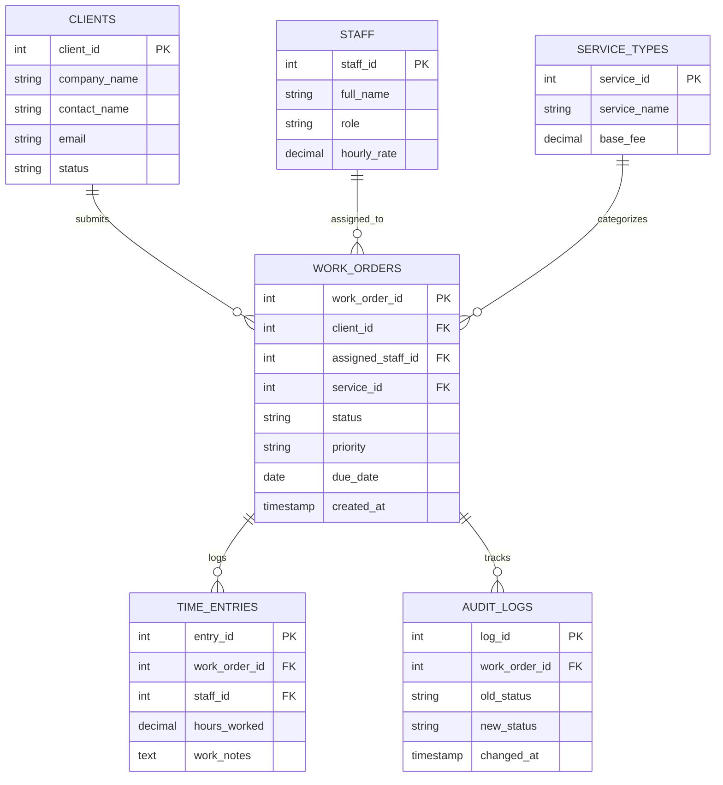

# Accounting & Inspection Work-Order Flow Database

A normalized relational database schema, audit-trail trigger system, and reporting suite modeled after real-world accounting and field-inspection office workflows.

## 🎯 The Business Problem
Service-based offices (such as CPA firms and inspection agencies) often rely on disconnected spreadsheets, paper intake forms, and manual status tracking. This creates bottlenecks:
* Lost or stalled work orders between intake, preparation, and partner review.
* Inconsistent client billing and unbilled hours.
* Lack of visibility into staff workload and turnaround times.

## 🏗️ Architecture & Database Design
This system enforces data integrity at the database level using **PostgreSQL**, featuring automated status-change auditing and pre-built reporting views.

### Entity-Relationship Diagram (ERD)


## ✨ Key Features
* **Normalized Schema (3NF):** Separates client records, service catalogs, staff assignments, and transactional work orders to eliminate data redundancy.
* **Automated Audit Trail:** A database trigger automatically logs every work-order status transition (`Intake` → `In Progress` → `Review` → `Completed` → `Billed`) with timestamps.
* **Executive Reporting Views:** Ready-to-query SQL views for **Overdue Work Orders**, **Staff Utilization**, and **Unbilled Revenue Summary**.

## 🚀 How to Run Locally
1. Ensure **PostgreSQL 14+** is installed (or run in a free cloud sandbox like Supabase / Neon / pgAdmin).
2. Execute the scripts in `/sql` in numerical order:
   ```bash
   psql -U your_username -d your_database -f sql/01_schema.sql
   psql -U your_username -d your_database -f sql/02_views_triggers.sql
   psql -U your_username -d your_database -f sql/03_seed_data.sql
   ```
3. Run `SELECT * FROM vw_active_work_orders;` to inspect the live workflow dashboard.
